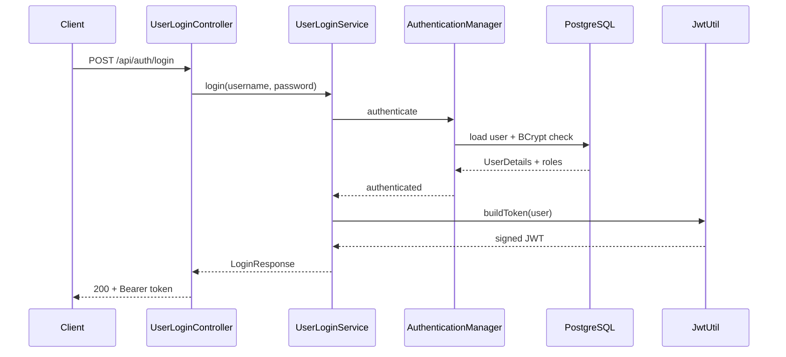
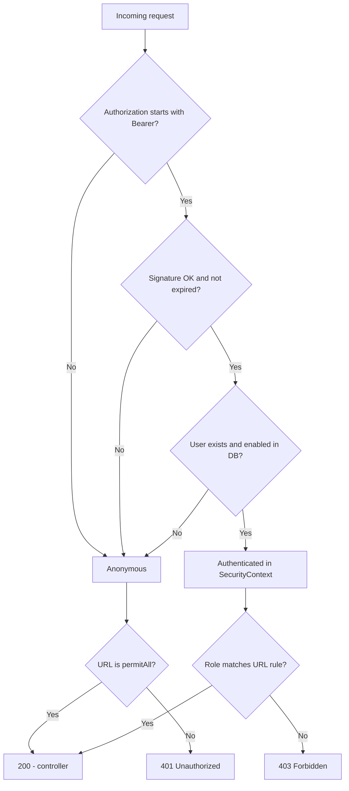

<div dir="rtl">

# JWT – פרויקט הגשה

---

## סטאק

| רכיב | גרסה / הערה |
|------|-------------|
| Java | 21 |
| Spring Boot | 4.1.1 |
| Spring Security + JWT (jjwt) | 0.13.0 |
| מסד נתונים | PostgreSQL 16 |
| כלים נוספים | JPA, Lombok, Validation |

הלקוח מדבר עם Spring MVC; `JwtAuthFilter` מאמת טוקן לפני הגעה ל-controller; משתמשים ותפקידים ב-PostgreSQL (יחס many-to-many דרך `user_roles`, סיסמאות כ-BCrypt).

---

## מפת אזורי אבטחה

| אזור | Prefix | טוקן | תפקיד מינימלי |
|------|--------|------|----------------|
| ציבורי | `/api/auth/**`, `/api/public/**` | לא נדרש | — |
| משתמש | `/api/user/**` | כן | `ROLE_USER` |
| מנהל | `/api/admin/**` | כן | `ROLE_ADMIN` |

---

## מה ה-API מציע

**אימות (ציבורי)**  
- `POST /api/auth/login` – מחזיר טוקן `Bearer`  
- `POST /api/auth/register` – רישום; תמיד מתקבל `ROLE_USER` בלבד (201)

**דוגמאות לנתיבים מוגנים**  
- `GET /api/public/hello` – ללא טוקן  
- `GET /api/user/me` – דורש `ROLE_USER`  
- `GET /api/admin/users` – דורש `ROLE_ADMIN`

| קוד | משמעות בפרויקט |
|-----|----------------|
| 200 | הצלחה |
| 201 | משתמש חדש נרשם |
| 400 | שדות לא תקינים (`@Valid`) |
| 401 | חסר/שגוי/פג תוקף JWT |
| 403 | מזוהה אך ללא תפקיד מתאים |
| 409 | שם משתמש תפוס |

---

## תרשים 1: התחברות וקבלת JWT

</div>



<div dir="rtl">

---

## תרשים 2: האם הבקשה מאושרת? (401 / 403)

מבוסס על `JwtAuthFilter` + `SecurityConfig` — שרת **stateless**, בלי session.

</div>



<div dir="rtl">

---

## זרימה בקצרה (טקסט)

1. **Login** – הסיסמה נבדקת מול BCrypt; `JwtUtil` מנפיק טוקן חתום (HS256).  
2. **בקשה מוגנת** – הפילטר מאמת JWT, טוען משתמש **מעודכן** מה-DB, וממלא `SecurityContext`.  
3. **הרשאות** – `SecurityConfig` לפי prefix של URL. הטוקן נשלח ב-`Authorization: Bearer …`.

בבקשה מוגנת: `JwtAuthFilter` → `JwtUtil` → DB → Controller. תוכן JWT **חתום ולא מוצפן** — לא לשים בו סודות.

---

## מבנה הפרויקט (תמצית)

```
src/main/java/com/example/jwtlesson/
  config/       SecurityConfig, DataInitializer
  controller/   auth + דוגמאות ל-public/user/admin
  dto/          בקשות/תשובות (records, בלי סיסמה בפלט)
  entity/       User, Role, RoleName
  repository/   UserRepository, RoleRepository
  security/     JwtUtil, JwtAuthFilter, CustomUserDetailsService
  service/      login, register, רשימת משתמשים
  exception/    טיפול ב-401/409/400 כ-JSON
```

`http/` – בדיקות IntelliJ (19 תרחישים) · `scripts/security-tests.ps1` – אותן בדיקות מול שרת חי.

---

## הרצה מקומית

### 1. PostgreSQL

```bash
docker compose up -d
```

חיבור: `localhost:5432`, DB `jwt_lesson`, משתמש/סיסמה `postgres`.

### 2. האפליקציה

`JwtLessonApplication` ב-IntelliJ · או `mvn spring-boot:run` · פורט **8080**.

### 3. משתמשים לדוגמה

| שם משתמש | סיסמה | תפקידים |
|----------|--------|---------|
| admin | Admin123! | ADMIN + USER |
| user | User123! | USER |

### 4. בדיקות

| אופן | פקודה / מיקום |
|------|----------------|
| IntelliJ | `http/security-tests.http`, סביבה `dev` |
| PowerShell | `.\scripts\security-tests.ps1` |
| Maven | `mvn test` (H2, 19 תרחישים) |

---

## נקודות אבטחה שיושמו

| נושא | יישום בפרויקט |
|------|----------------|
| אחסון סיסמה | BCrypt בלבד |
| הרשאות | Roles ב-DB, לא מהלקוח ב-register |
| Enumeration | אותה הודעת 401 ל-login שגוי |
| Session | Stateless + JWT בכותרת |
| תפקידים מעודכנים | טעינת user מה-DB בכל בקשה בפילטר |
| 401 מול 403 | `authenticationEntryPoint` + `accessDeniedHandler` |

---

## מקור והשראה

מבוסס על תרגיל Spring Security + JWT (מבנה דומה לשיעור jwt-lesson), עם הרחבות להרצה, בדיקות ותיעוד להגשה.

</div>
