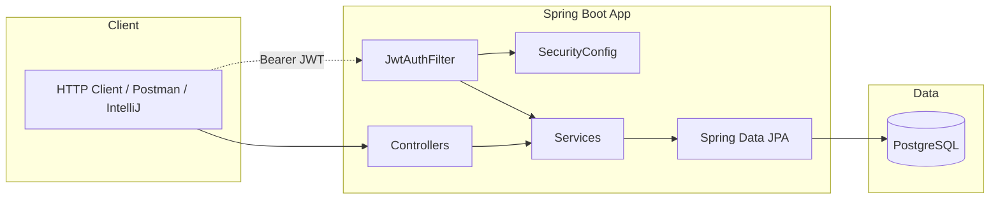
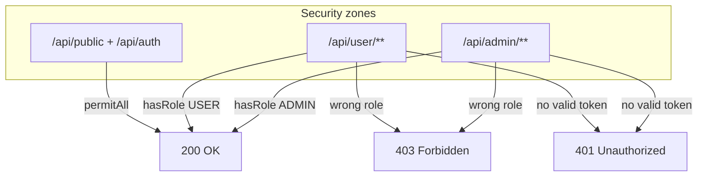
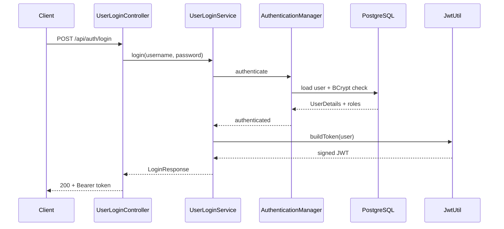
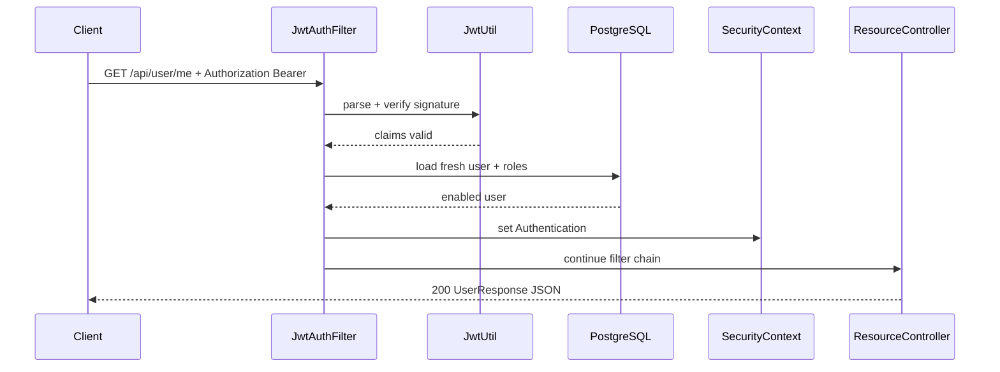
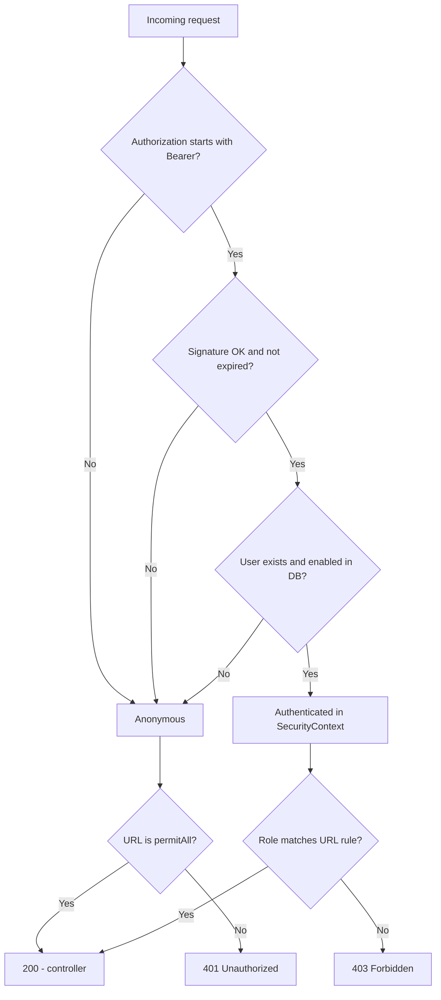
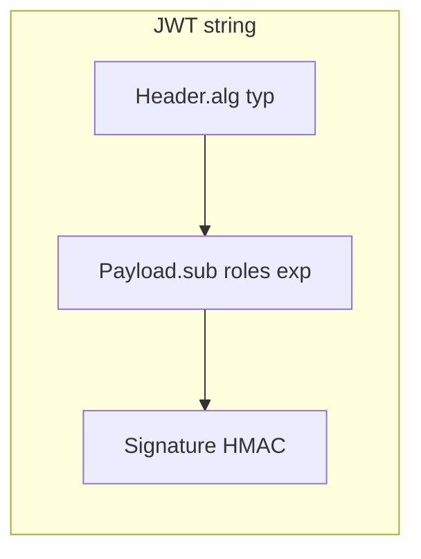
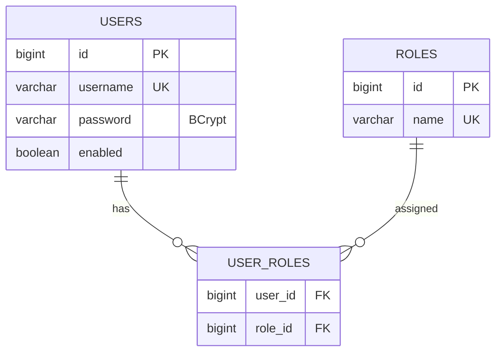
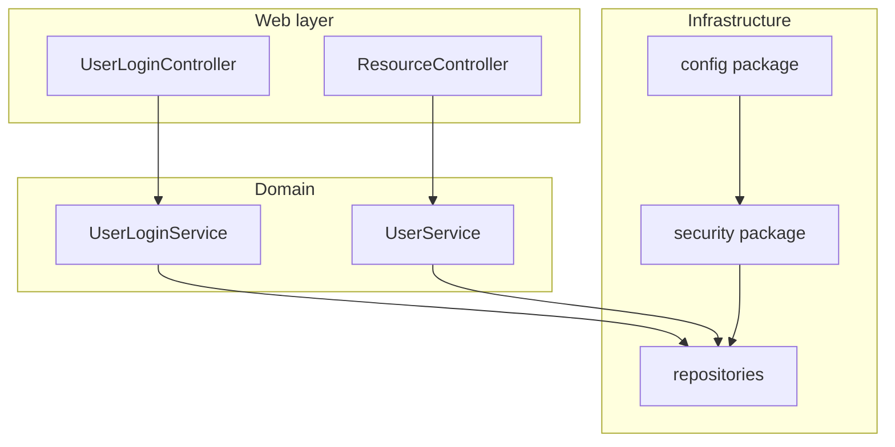

<div dir="rtl">

# JWT – פרויקט הגשה

מימוש של REST API מאובטח: התחברות עם שם משתמש וסיסמה, קבלת **JWT**, וגישה לנתיבים שונים לפי **תפקיד** (משתמש רגיל / מנהל).

[](https://openjdk.org/)
[](https://spring.io/projects/spring-boot)
[](https://www.postgresql.org/)
[](https://github.com/jwtk/jjwt)

**מאגר:** [github.com/NoamBehor/JWT](https://github.com/NoamBehor/JWT)

---

## סטאק

| רכיב | גרסה / הערה |
|------|-------------|
| Java | 21 |
| Spring Boot | 4.1.1 |
| Spring Security + JWT (jjwt) | 0.13.0 |
| מסד נתונים | PostgreSQL 16 |
| כלים נוספים | JPA, Lombok, Validation |

---

## ארכיטקטורה – מבט על

הלקוח מדבר רק עם Spring MVC. אימות מתבצע בפילטר לפני שהבקשה מגיעה ל-controller; נתוני משתמשים ותפקידים נשמרים ב-PostgreSQL.

</div>



<div dir="rtl">

---

## מפת אזורי אבטחה

| אזור | Prefix | טוקן | תפקיד מינימלי |
|------|--------|------|----------------|
| ציבורי | `/api/auth/**`, `/api/public/**` | לא נדרש | — |
| משתמש | `/api/user/**` | כן | `ROLE_USER` |
| מנהל | `/api/admin/**` | כן | `ROLE_ADMIN` |

</div>



<div dir="rtl">

---

## מה ה-API מציע

**אימות (ציבורי)**  
- `POST /api/auth/login` – מחזיר טוקן `Bearer`  
- `POST /api/auth/register` – רישום; תמיד מתקבל `ROLE_USER` בלבד (201)

**דוגמאות לנתיבים מוגנים**  
- `GET /api/public/hello` – ללא טוקן  
- `GET /api/user/me` – דורש `ROLE_USER`  
- `GET /api/admin/users` – דורש `ROLE_ADMIN`

| קוד | משמעות בפרויקט |
|-----|----------------|
| 200 | הצלחה |
| 201 | משתמש חדש נרשם |
| 400 | שדות לא תקינים (`@Valid`) |
| 401 | חסר/שגוי/פג תוקף JWT |
| 403 | מזוהה אך ללא תפקיד מתאים |
| 409 | שם משתמש תפוס |

---

## תרשים רצף: התחברות (Login)

</div>



<div dir="rtl">

---

## תרשים רצף: בקשה מוגנת

</div>



<div dir="rtl">

---

## עץ החלטות: האם הבקשה מאושרת?

מבוסס על `JwtAuthFilter` + `SecurityConfig` (stateless, בלי session).

</div>



<div dir="rtl">

---

## מבנה טוקן JWT (HS256)

הטוקן **חתום** אבל **לא מוצפן** – כל מי שמחזיק בו יכול לקרוא את ה-payload; לכן לא שמים בו סיסמאות או מידע רגיש.

</div>



<div dir="rtl">

---

## מודל נתונים

יחס **רבים-לרבים** בין משתמשים לתפקידים (`user_roles`). סיסמה בטבלה `users` – רק hash BCrypt.

</div>



<div dir="rtl">

---

## זרימה בקצרה (טקסט)

1. **Login** – הסיסמה נבדקת מול BCrypt ב-DB; בהצלחה `JwtUtil` מנפיק טוקן חתום (HS256).  
2. **בקשה עם טוקן** – `JwtAuthFilter` מאמת חתימה ותוקף, טוען את המשתמש **מחדש** מה-DB (כולל תפקידים), וממלא `SecurityContext`.  
3. **הרשאות** – `SecurityConfig` קובע לפי prefix של URL.

השרת **stateless**: אין session; הטוקן נשלח בכותרת `Authorization: Bearer …`.

---

## מבנה הפרויקט (תמצית)

</div>



<div dir="rtl">

```
src/main/java/com/example/jwtlesson/
  config/       SecurityConfig, DataInitializer
  controller/   auth + דוגמאות ל-public/user/admin
  dto/          בקשות/תשובות (records, בלי סיסמה בפלט)
  entity/       User, Role, RoleName
  repository/   UserRepository, RoleRepository
  security/     JwtUtil, JwtAuthFilter, CustomUserDetailsService
  service/      login, register, רשימת משתמשים
  exception/    טיפול ב-401/409/400 כ-JSON
```

בתיקיית `http/` – בדיקות IntelliJ HTTP Client (19 תרחישים).  
בתיקיית `scripts/` – `security-tests.ps1` לאותן בדיקות מול שרת חי.

---

## הרצה מקומית

### 1. PostgreSQL

```bash
docker compose up -d
```

חיבור: `localhost:5432`, DB `jwt_lesson`, משתמש/סיסמה `postgres` (ניתן לדרוס עם `DB_USER` / `DB_PASSWORD`).

### 2. האפליקציה

IntelliJ: `JwtLessonApplication` · או `mvn spring-boot:run` · פורט **8080**.

### 3. משתמשים לדוגמה

| שם משתמש | סיסמה | תפקידים |
|----------|--------|---------|
| admin | Admin123! | ADMIN + USER |
| user | User123! | USER |

### 4. בדיקות

| אופן | פקודה / מיקום |
|------|----------------|
| IntelliJ | `http/security-tests.http`, סביבה `dev`, Run All |
| PowerShell | `.\scripts\security-tests.ps1` |
| Maven | `mvn test` (H2 בזיכרון, 19 תרחישים) |

---

## נקודות אבטחה שיושמו

| נושא | יישום בפרויקט |
|------|----------------|
| אחסון סיסמה | BCrypt בלבד |
| הרשאות | Roles ב-DB, לא מהלקוח ב-register |
| Enumeration | אותה הודעת 401 ל-login שגוי |
| Session | Stateless + JWT בכותרת |
| תפקידים מעודכנים | טעינת user מה-DB בכל בקשה בפילטר |
| 401 מול 403 | `authenticationEntryPoint` + `accessDeniedHandler` מפורשים |

---

## מקור והשראה

הפרויקט מבוסס על תרגיל Spring Security + JWT (מבנה דומה לשיעור jwt-lesson), עם הרחבות: `docker-compose`, בדיקות Maven, סקריפט PowerShell ותיעוד עם תרשימים להגשה.

</div>
